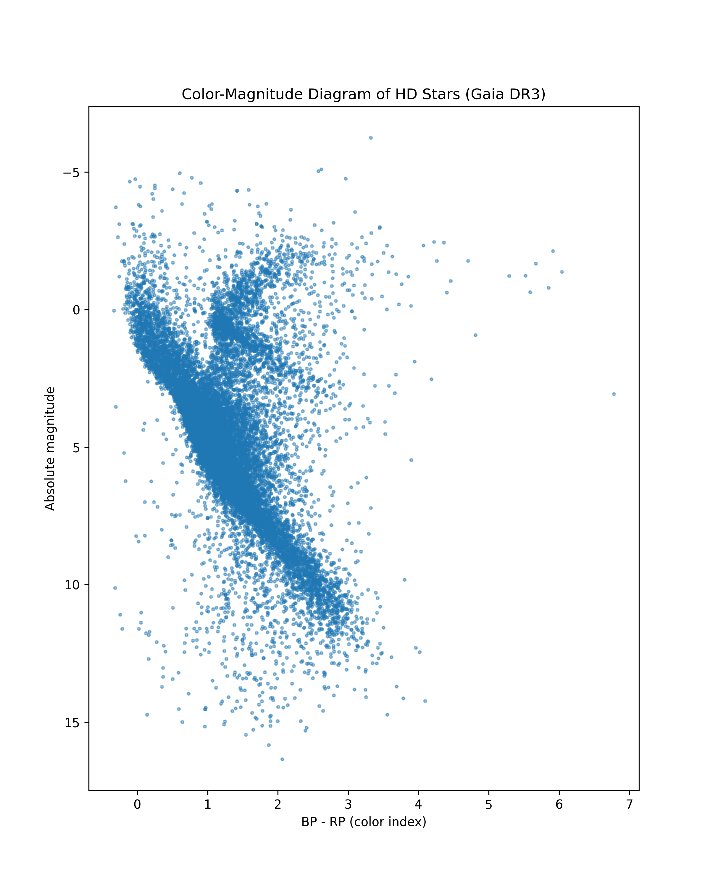

# Gaia DR3 – Henry Draper Catalogue Cross-Matching

## Overview

This project explores stellar data by combining information from the Henry Draper Catalogue (HD) and Gaia Data Release 3 (DR3).

The Henry Draper Catalogue provides stellar identifiers and spectral classifications, while Gaia DR3 provides astrometric and photometric measurements. The matched dataset is used to construct a colour–magnitude diagram and explore the distribution of stars.

## Objectives

- Explore a cross-matched stellar dataset combining the Henry Draper Catalogue and Gaia DR3.
- Clean the data and retain stars with positive parallaxes.
- Estimate stellar distances from Gaia parallaxes.
- Calculate absolute G-band magnitudes.
- Filter stars according to their relative parallax uncertainty.
- Plot a Gaia colour–magnitude diagram using BP–RP colour and absolute G magnitude.

## Methodology

### Data Cleaning

Rows containing missing values in parallax, parallax uncertainty, G magnitude, or BP–RP colour were removed. Only stars with positive parallaxes were retained.

### Distance Estimation

Distances were estimated from parallaxes expressed in milliarcseconds (mas):

Distance (pc) = 1000 / Parallax (mas)

### Absolute Magnitude

The absolute G-band magnitude was calculated using the distance modulus:

M_G = G - 5 log10(d) + 5

### Parallax Uncertainty Filtering

To reduce the impact of uncertain distance estimates, stars with relative parallax uncertainties below 20% were retained:

Parallax uncertainty / Parallax < 0.20 (20%)

### Colour–Magnitude Diagram

The diagram was constructed using:

- **X-axis:** BP–RP colour index
- **Y-axis:** Absolute G-band magnitude

The magnitude axis is inverted, following the conventional representation of stellar colour–magnitude diagrams.

## Results

The relative parallax uncertainty filter produces a cleaner colour–magnitude distribution, making the main stellar sequence more distinguishable.

## Tools

- Python
- NumPy
- Pandas
- Matplotlib

## Limitations

- Distances are estimated using the inverse-parallax relation.
- A relative parallax uncertainty threshold of 20% is used as a practical selection criterion.
- No extinction correction is applied.
- The matched dataset is not a complete or unbiased sample of the Milky Way stellar population.

